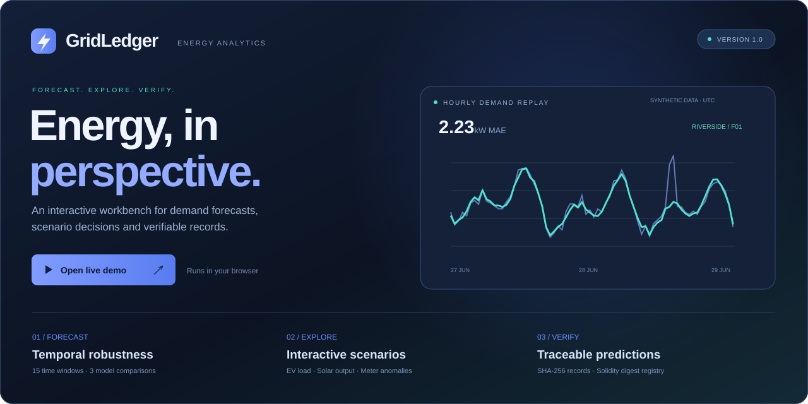
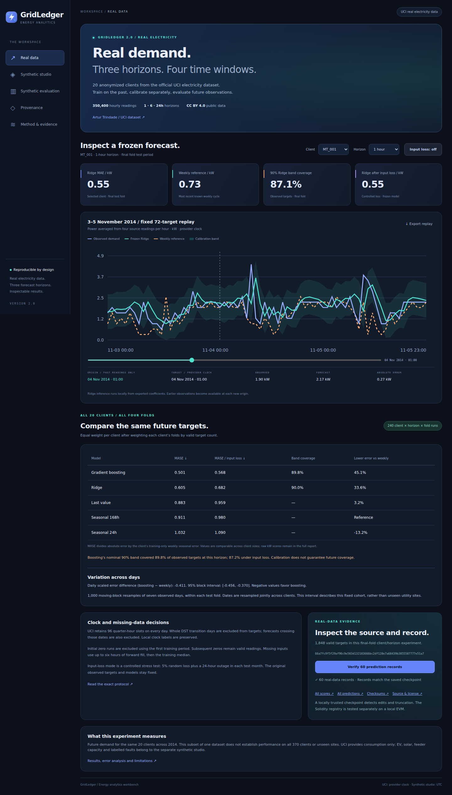

<a href="https://sarvenaz-m.github.io/GridLedger/">
  
</a>

<p align="center"><a href="https://sarvenaz-m.github.io/GridLedger/"></a></p>

<p align="center"><b>Version 2.0</b> · Python + JavaScript + Solidity · Real UCI electricity benchmark</p>

**Forecast real electricity demand. Measure temporal error. Inspect the evidence.**

GridLedger evaluates 20 electricity clients across four future time windows and direct 1/6/24-hour horizons. It includes causal preprocessing, five model/baseline comparisons, separate calibration, controlled telemetry loss and every saved prediction. The browser recomputes frozen Ridge models locally. A Solidity registry is tested with both real and synthetic prediction digests on an ephemeral EVM.

[Live workbench](https://sarvenaz-m.github.io/GridLedger/) · [Real-data protocol](docs/REAL_DATA.md) · [Executed results](docs/RESULTS.md) · [Security model](docs/THREAT_MODEL.md)

## What changed in version 2

- **Licensed real input:** official UCI source, fixed MT_001–MT_020 cohort, 2013–2014, 350,400 hourly client readings. The source and conversion are attributed under CC BY 4.0.
- **Temporal evaluation:** four expanding training periods, separate 14-day calibration, disjoint test windows, and future labels purged at every boundary.
- **Multiple horizons:** direct 1/6/24-hour models with last-value, daily and weekly baselines that only read available history.
- **Data quality:** explicit provider-clock/DST policy, training-derived activation dates, preserved later zeros and causal gap handling.
- **Robustness:** frozen models under 5% random input loss plus 24-hour monthly outages, evaluated against original observed targets.
- **Auditable evidence:** all 438,720 targets/predictions, per-fold scores, daily block uncertainty, client/hour error analysis, manifests and 60 real prediction records.
- **Real-data workspace:** select any client/horizon, inspect a 72-target replay, compare cohort results, toggle input loss, export CSV and verify records.

The existing **synthetic studio** remains separately labelled: three fictional feeders, EV/PV scenarios, injected anomaly labels, one-hour replay and its original five-fold temporal audit. These inputs are not attributed to UCI.

## Executed real-data results

Lower MASE is better. Each fold's denominator uses valid training weekly seasonal error; folds are weighted by target count within a client, then clients receive equal weight.

| Horizon | Last value | Daily seasonal | Weekly seasonal | Ridge | Gradient boosting | Boosting band coverage |
|---|---:|---:|---:|---:|---:|---:|
| 1h | 0.883 | 1.032 | 0.911 | 0.605 | 0.501 | 89.8% |
| 6h | 2.529 | 1.032 | 0.913 | 0.769 | 0.692 | 88.9% |
| 24h | 1.027 | 1.027 | 0.912 | 0.804 | 0.771 | 87.1% |

Boosting reduces macro MASE relative to the held-out weekly baseline by **45.1%, 24.1% and 15.5%** at 1/6/24 hours. It does not win for every client: the weekly baseline is better for MT_003 at all horizons and also MT_001/MT_015 at 24 hours. Its 24-hour nominal 90% band covers only **87.1%** of targets. These exceptions remain visible in the report.


This measures future consumption on the same 20 clients in one public dataset. It does not establish unseen-site generalization or operational grid performance. [Full interpretation and error analysis](docs/RESULTS.md).

## Verify the release

| Executed check | Evidence |
|---|---:|
| Python causal, temporal, QC and integrity tests | **51 passed** |
| Real client × horizon × fold runs | **240** |
| Model/baseline evaluations on clean targets | **1,200**, plus 1,200 input-loss evaluations |
| Saved prediction rows independently re-scored | **438,720** |
| Python/JavaScript parity | **4,320 real + 216 synthetic predictions** |
| Real prediction records verified | **60** |
| Solidity local EVM checks | **9 passed** |
| Chromium desktop and mobile | **1440×1000 / 390×844; no page errors or horizontal overflow** |

Checksums and evidence are in [`results/`](results/). CI validates committed real predictions offline, regenerates synthetic evidence, runs Python/Node tests and checks the actual UI. An optional manual workflow downloads the pinned source and refits the real benchmark. [Workflow](.github/workflows/validate.yml).

## Open the application

```sh
python -m http.server 8000
```

Open `http://localhost:8000`. The application uses local static assets, with no account, API key or external runtime service. HTTPS or localhost enables browser SHA-256 verification.

<a href="https://sarvenaz-m.github.io/GridLedger/"></a>

[Actual mobile screenshot](assets/real-mobile.png).

## Reproduce locally

Python 3.11+ and Node 20+:

```sh
python -m venv .venv
# macOS/Linux: source .venv/bin/activate
# Windows: .venv\Scripts\activate
python -m pip install -e '.[plots]'
gridledger-verify --root .      # verify every committed real prediction
gridledger-real --root .        # refit using the committed real extract
python scripts/plot-real.py
gridledger --out .              # reproduce the separate synthetic studio
gridledger-audit --root .
python -m unittest discover -s tests -v
npm ci
npm run test:browser-model
npm run test:real-model
npm run test:contract
npx playwright install chromium
npm run test:ui
```

`npm run test:ui` starts and stops its own local static server. On Linux, install browser system dependencies with `npx playwright install --with-deps chromium` when needed. Core Python packages and Playwright are pinned; JavaScript dependencies are locked.

The **real extract is committed**; ordinary fitting needs no data download. To independently recreate it from UCI:

```sh
gridledger-fetch --root .
gridledger-real --root .
gridledger-verify --root .
```

The original ~249 MiB ZIP is cached outside versioned inputs. The compressed prediction file preserves floating-point precision and deterministic gzip metadata. [Exact source/clock/forecast protocol](docs/REAL_DATA.md).

## Repository map

| Path | Purpose |
|---|---|
| `index.html`, `assets/real-view.js`, `assets/real-data.*` | Actual real-data workspace and frozen browser inference |
| `src/gridledger/real_data.py` | Pinned official source, hourly conversion, clock and activation QC |
| `src/gridledger/real.py` | Direct forecasting, purged folds, calibration, input loss, statistics and export |
| `src/gridledger/verify.py` | Checksums and independent re-scoring of every prediction |
| `data/uci_hourly.csv`, `data/uci_source.json` | Attributed real extract and provenance |
| `results/real_*`, `results/figures/` | Scores, full predictions, error analysis, manifests and scientific figures |
| `src/gridledger/pipeline.py`, `src/gridledger/audit.py` | Preserved synthetic experiment and audit |
| `src/gridledger/provenance.py`, `contracts/PredictionRegistry.sol` | Local chains and authorized digest anchoring |
| `tests/`, `scripts/` | Scientific checks, JavaScript parity, real browser and EVM validation |

## License

Code and the original synthetic experiment: [MIT](LICENSE). UCI-derived data and evidence: **CC BY 4.0**, with attribution to Artur Trindade and the UCI Machine Learning Repository. [Third-party notice](THIRD_PARTY_NOTICES.md) records the source and modifications.
