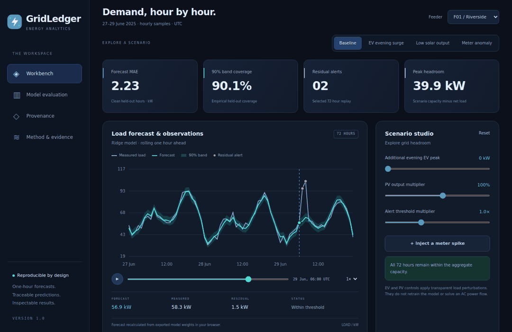

<a href="https://sarvenaz-m.github.io/GridLedger/">
  
</a>

<p align="center">
  <a href="https://sarvenaz-m.github.io/GridLedger/"></a>
</p>

<p align="center"><b>Version 1.0</b> · Python + JavaScript + Solidity · Reproducible synthetic experiment</p>

**Forecast electricity demand. Explore changing conditions. Follow every prediction back to its evidence.**

GridLedger combines an interactive energy analytics workbench with a reproducible forecasting pipeline, temporal robustness audits and verifiable prediction records. The browser evaluates exported model weights locally. A separate Solidity registry anchors prediction and artifact digests.

[Live workbench](https://sarvenaz-m.github.io/GridLedger/) · [Methodology](docs/METHODOLOGY.md) · [Temporal audit](docs/TEMPORAL_AUDIT.md) · [Security model](docs/THREAT_MODEL.md)

<a href="https://sarvenaz-m.github.io/GridLedger/">
  
</a>

*Animated preview — click the image to use the interactive application.*

## Explore the workbench

| Workspace | Try it |
|---|---|
| **Demand replay** | Select a feeder, play the 72-hour timeline, inspect a point or move with the arrow keys. |
| **Scenario studio** | Apply the EV surge, low-solar or meter-anomaly preset; tune every parameter and export the result. |
| **Model evaluation** | Compare model errors, interval coverage and five expanding-window evaluations per feeder. |
| **Distribution monitor** | Inspect training-reference PSI and normalized Wasserstein scores across four input features. |
| **Prediction provenance** | Attest a forecast, verify the record chain, test a modification and restore the valid snapshot. |
| **Interactive tour** | Walk through forecasting, scenarios, anomaly inspection, evaluation and verification in five steps. |

## Engineering behind the interface

- **Causal features:** shifted load lags, historical rolling means, calendar harmonics and forecast-time exogenous inputs.
- **Temporal evaluation:** separate training, calibration and test windows; fixed hyperparameters; refitting at each expanding-window fold.
- **Input contracts:** required fields, finite values, physical input bounds, unique timestamps, hourly cadence and aligned step indices.
- **Distribution diagnostics:** training-fitted quantile bins, smoothed population stability scores and scale-normalized Wasserstein distances.
- **Reproducible artifacts:** deterministic generation, atomic audit writes, dataset/model digests and checksum manifests.
- **Cross-runtime inference:** Python coefficients and scaler parameters evaluated by the same browser core used in the demo.
- **Digest registry:** authorized writers, unique record identifiers and overwrite protection, exercised on a local EVM.
- **Portable frontend:** responsive static files, reduced-motion support, keyboard controls and a standalone browser runtime.

## Executed evidence

| Check | Result |
|---|---:|
| Python research, input-contract and integrity tests | **25 passed** |
| Expanding-window evaluations | **15 folds** |
| Model/baseline evaluations across those folds | **45** |
| Descriptive distribution comparisons | **60** |
| Python/browser prediction parity | **216 predictions** |
| Solidity / local EVM checks | **8 passed** |

The recorded evidence is available in [`results/`](results/). Continuous validation is defined in [the workflow](.github/workflows/validate.yml).

## Temporal robustness

Five disjoint 20-day test windows follow expanding training periods and separate 20-day calibration windows. Values below are pooled clean-hour MAE in kW from the executed audit.

| Feeder | Ridge | Gradient boosting | 24h seasonal baseline | Mean interval coverage |
|---|---:|---:|---:|---:|
| F01 · Riverside | 2.22 | 2.55 | 5.09 | 90.3% |
| F02 · University | 3.00 | 3.47 | 6.91 | 90.5% |
| F03 · Harbour | 3.77 | 4.43 | 8.56 | 90.3% |

These values describe the deterministic synthetic experiment. The three feeders share a data-generating design. Per-fold errors, all-hour coverage, calibration contamination counts and distribution scores are in [`advanced_audit.json`](results/advanced_audit.json). The original final-month benchmark is preserved in [`metrics.json`](results/metrics.json).

## Run locally

```sh
python -m http.server 8000
```

Open `http://localhost:8000`. The interface has no external fonts, trackers, API keys or CDN dependencies. HTTPS or localhost enables browser SHA-256 attestation.

## Reproduce the full pipeline

Python 3.11+ and Node 20+:

```sh
python -m venv .venv
# macOS/Linux: source .venv/bin/activate
# Windows: .venv\Scripts\activate
python -m pip install -e .
gridledger --out .
gridledger-audit --root .
python -m unittest discover -s tests -v
npm ci
npm run test:browser-model
npm run test:contract
```

The experiment generates 12,960 observations, model weights, predictions and metrics. The audit independently reads the versioned CSV, verifies its contract and writes additional evidence without replacing the inference model. Dependency versions and random seeds are recorded. See [methodology](docs/METHODOLOGY.md) and [audit design](docs/TEMPORAL_AUDIT.md).

## Repository map

| Path | Purpose |
|---|---|
| `index.html`, `assets/` | Interactive workbench, model runtime, audit view and repository artwork |
| `src/gridledger/pipeline.py` | Simulation, feature engineering, training and export |
| `src/gridledger/audit.py` | Data contracts, temporal evaluation and distribution diagnostics |
| `src/gridledger/provenance.py` | Canonical records and hash-chain verification |
| `contracts/PredictionRegistry.sol` | Authorized append-only digest registry |
| `tests/`, `scripts/` | Scientific checks, cross-runtime parity and local EVM execution |
| `data/`, `results/` | Synthetic inputs and reproducible evidence |

## Interpretation and security

The scenario engine applies explicit EV and PV perturbations to aggregate load. The model's forecast horizon is one hour, evaluated sequentially. Prediction bands and distribution scores are descriptive measures on temporally dependent data. Engineering assumptions and external-validation requirements are documented in [methodology](docs/METHODOLOGY.md).

Browser attestations are local session records. A separately trusted checkpoint is needed to detect a complete history rewrite. The Solidity registry is tested on a local EVM; see the [security model](docs/THREAT_MODEL.md) for the trust assumptions and controls.

## License

MIT for source and original graphics. Generated synthetic data use the same license. Third-party packages retain their own licenses.
