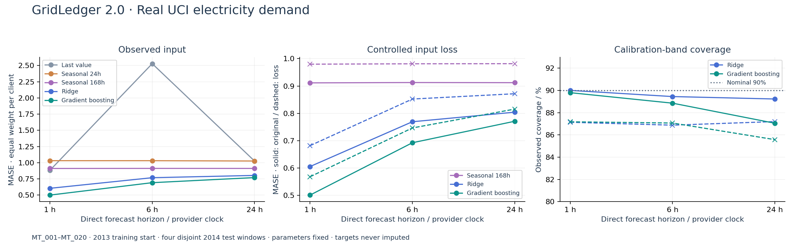
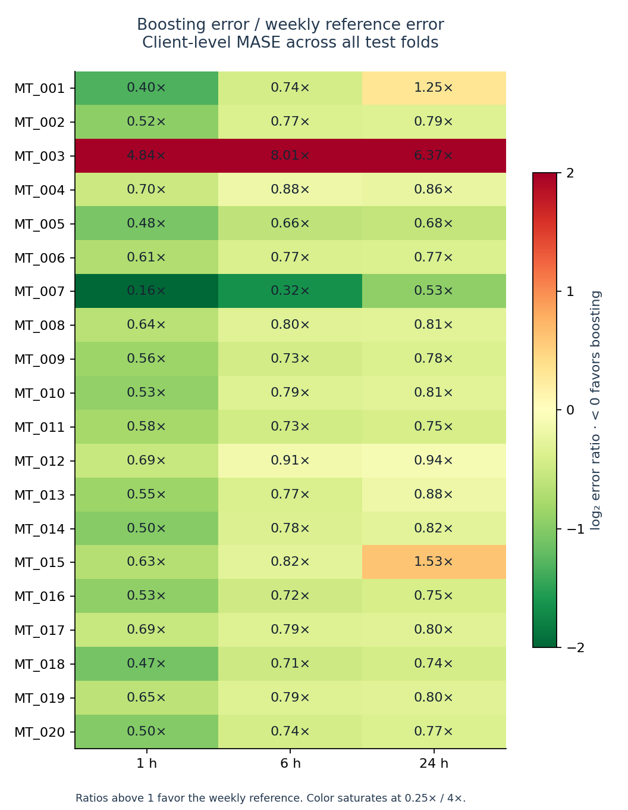
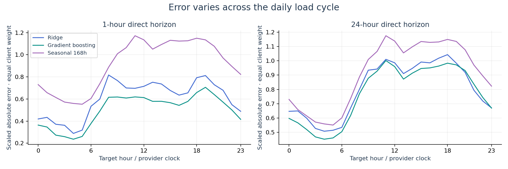

# Executed results · GridLedger 2.0

The released benchmark uses 20 fixed UCI clients, 2013 training history and four disjoint 2014 test periods. Parameters were fixed before evaluation. All 438,720 scored target rows and clean/input-loss predictions are saved in [real_predictions.csv.gz](../results/real_predictions.csv.gz).

## Main comparison

| Horizon | Last value | Daily seasonal | Weekly seasonal | Ridge | Boosting | Boosting coverage |
|---|---:|---:|---:|---:|---:|---:|
| 1h | 0.883 | 1.032 | 0.911 | 0.605 | 0.501 | 89.8% |
| 6h | 2.529 | 1.032 | 0.913 | 0.769 | 0.692 | 88.9% |
| 24h | 1.027 | 1.027 | 0.912 | 0.804 | 0.771 | 87.1% |

Values are macro MASE. All methods share the same valid targets. Scaling uses each client's valid training weekly error. The held-out weekly baseline can score below 1 because that value describes its training denominator. [Full per-fold kW/MASE scores](../results/real_benchmark.json).

Boosting's macro MASE is 45.1% / 24.1% / 15.5% lower than the weekly baseline at 1 / 6 / 24 hours. Its paired daily scaled-error contrasts against the weekly baseline are:

| Horizon | Mean daily difference | 95% moving-block interval |
|---|---:|---|
| 1h | -0.411 | [-0.456, -0.370] |
| 6h | -0.220 | [-0.254, -0.185] |
| 24h | -0.140 | [-0.177, -0.106] |

Negative values favor boosting. The 1,000 replicates resample seven observed days within each fold, jointly across clients. These are descriptive intervals for this cohort. The daily statistic differs slightly from observation-weighted primary MASE.

## Input-loss experiment

| Horizon | Original boosting MASE | Input-loss MASE | Original coverage | Input-loss coverage |
|---|---:|---:|---:|---:|
| 1h | 0.501 | 0.568 | 89.8% | 87.2% |
| 6h | 0.692 | 0.746 | 88.9% | 87.1% |
| 24h | 0.771 | 0.815 | 87.1% | 85.6% |

Controlled loss masks 5% random test inputs plus monthly 24-hour outages. Original observed targets remain unchanged. Forward fill stops after six hours, then a training median is used. No retraining or recalibration follows the outage. This stress test does not claim the provider had missing measurements.

Coverage worsens under input loss. Even with original input, the 24-hour boosting band covers 87.1% rather than its nominal 90%. Treat the band as an empirical diagnostic under these conditions.

## Failures and client variation

Boosting beats the weekly baseline on **19/20 clients** at 1 and 6 hours, and **17/20** at 24 hours. Every client remains in the published comparison.

- **MT_003:** weekly repetition is much stronger at all horizons. At one hour, weekly MAE is about 0.0062 kW versus boosting's 0.0414 kW. Its small training weekly scale also makes relative differences sensitive. The 6-hour macro client error ratio reaches 8.01×.
- **MT_001:** at 24 hours, boosting's client MASE is 0.9795 versus weekly 0.7818. Its 6-hour Ridge also beats boosting on this client. The cohort average does not determine the best model for each client.
- **MT_015:** at 24 hours, boosting's client MASE is 1.2871 versus weekly 0.8420. This client starts after the extract begins and stays in the benchmark under the activation rule.

These findings are descriptive error analysis. Hyperparameters were not retuned after seeing them, and clients were not removed.

Hourly errors expose variation across the daily cycle. Each curve first averages a client's valid scaled errors at that target hour, then weights all clients equally. The [machine-readable error analysis](../results/real_error_analysis.json) records the values.

## What was verified

- Official archive pin and source member digest; complete hourly grid and source attribution.
- All 51 Python tests, including present/future exclusion, long-horizon baseline availability, boundary purging, activation/DST rules, causal imputation and manifest tampering.
- Independent re-scoring of all 438,720 rows: original targets, causal clean/stressed baselines, training medians/scales, MAE/RMSE/MASE and interval coverage.
- 4,320 real and 216 synthetic Python/JavaScript predictions; maximum real difference below 2e-13 kW.
- 60 real prediction records; modification/truncation detection.
- Nine local EVM checks, including the real checkpoint and its own artifact manifest.
- Actual Chromium 154.0.8037.92 interactions at 1440×1000 and 390×844, with no page errors, failed requests or horizontal page overflow.

The source extraction and real-model experiment were repeated. The reported aggregate scores were identical in the recorded environment; the release stores round-trip prediction precision. Numerical results on other platforms may differ slightly.

## Interpretation and next research questions

This validates a reproducible time-series workflow on real measurements: causal information timing, data quality, calibration, controlled loss and client-level error analysis. These practices transfer to other measured signals and complement research experience in signal analysis and machine learning.

The scope is future time on 20 known clients in one dataset. It does not measure unseen-client/site performance, causal EV effects, network constraints or fault detection. The real source contains neither weather forecasts nor EV/PV/fault labels. The separate synthetic studio documents those scenario assumptions.

Useful next experiments are a fixed extension to all eligible clients, explicit unseen-client evaluation with a shared model, robust calibration under shift, and additional sources with documented forecast-time weather. Any model selection should use a new validation protocol before evaluating a fresh held-out period.
